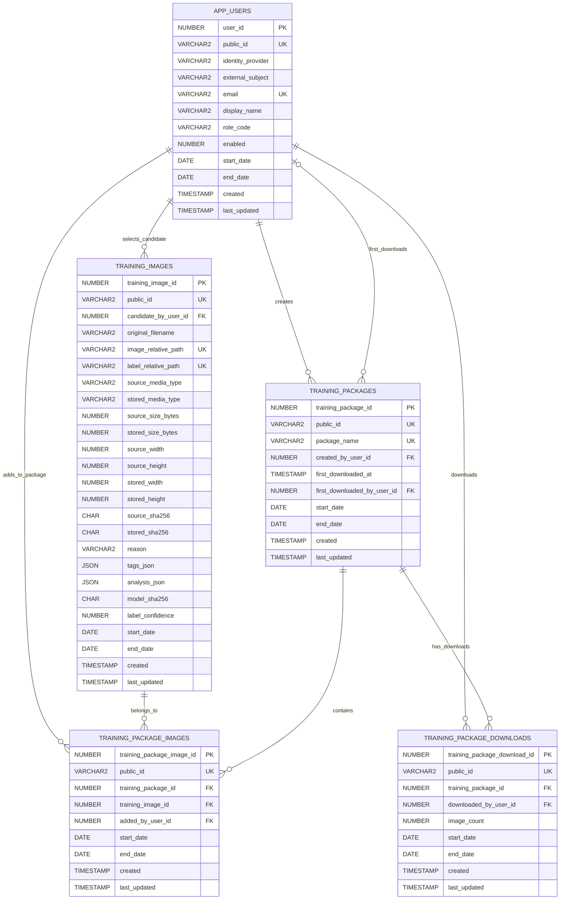

# Tallinna liiklustuvastuse aktiivõppe ERD

## 1. Dokumendi päritolu

Dokumendi koostas OpenAI Codex 24. novembril 2026 kasutaja kinnitatud
aktiivõppe, kasutajate, treeningpiltide ja treeningpakkide nõuete põhjal.

## 2. Mermaid ER-diagramm

## 3. Olulised reeglid

- `TRAINING_PACKAGES.package_name` on unikaalne.
- Sama pilt võib kuuluda mitmesse paketti; sama pildi ja paketi aktiivne seos
  võib esineda ainult üks kord.
- Paketi koosseisu võib muuta kuni esimese allalaadimiseni. Esimene
  allalaadimine väärtustab `first_downloaded_at` ja lukustab koosseisu.
- `TRAINING_IMAGES.created` näitab kandidaadiks märkimise aega ning
  `TRAINING_PACKAGE_IMAGES.created` konkreetsesse paketti lisamise aega.
- Viimane allalaadija ja aeg leitakse `TRAINING_PACKAGE_DOWNLOADS` kõige
  uuemast kirjest.
- Pilt ja YOLO `.txt` asuvad kettal. Pildi kustutamisel failid eemaldatakse,
  kuid Oracle'i metaandmed ja pakiseosed säilivad soft delete'iga.

